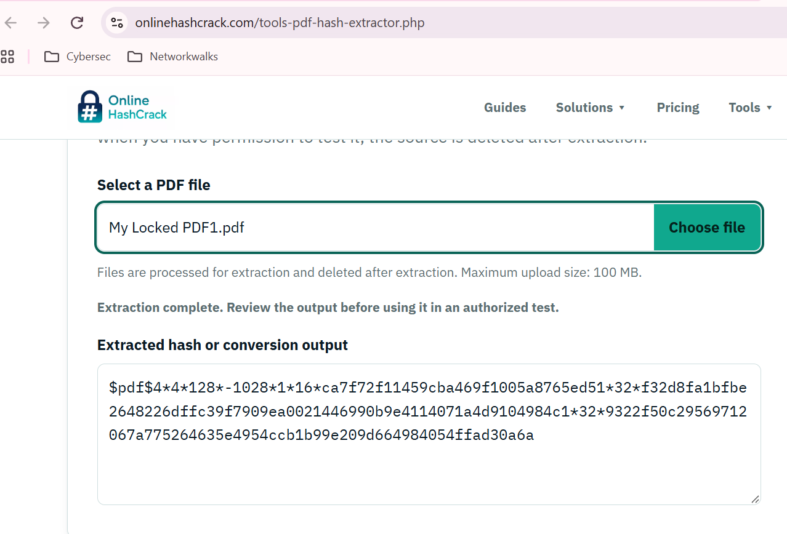
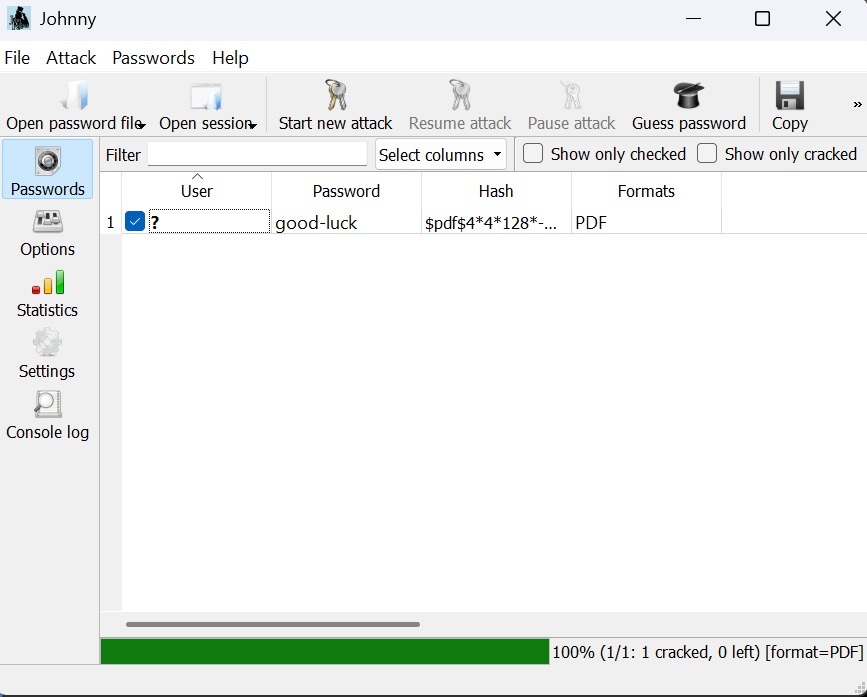
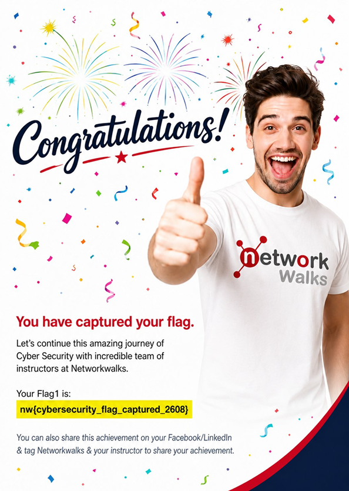
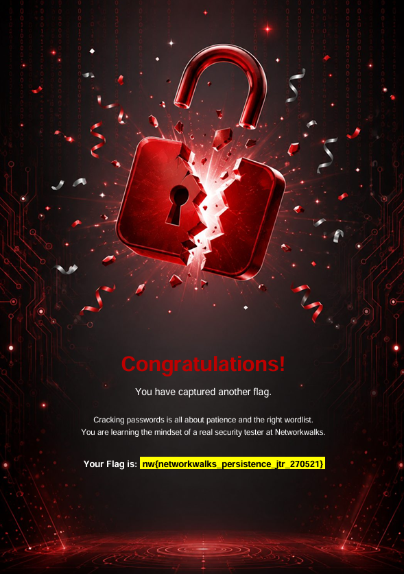
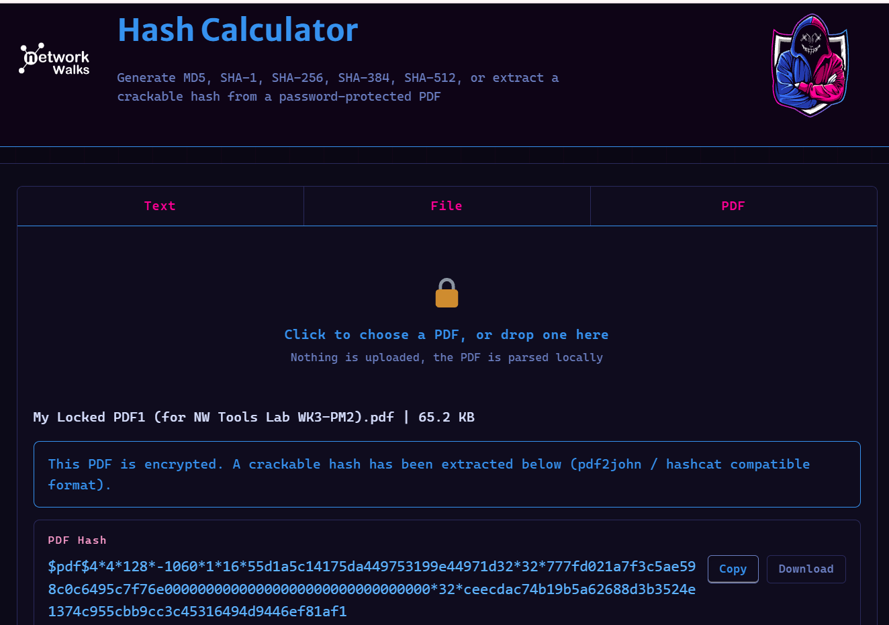
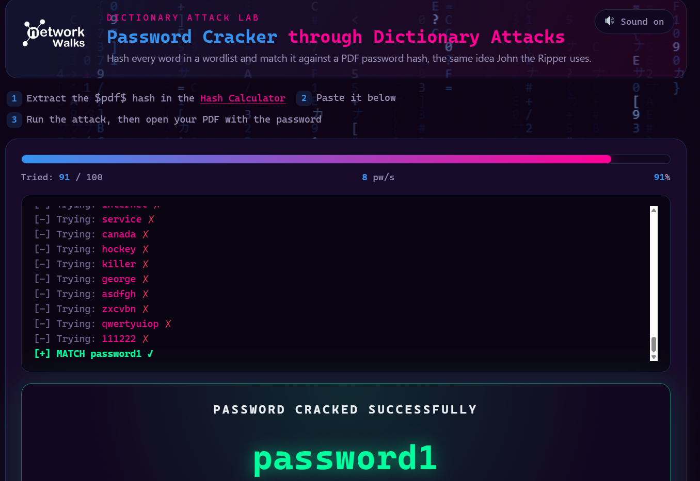

#  Password Cracking Labs — Cybersecurity & Ethical Hacking

A pair of hands-on labs demonstrating how password-protected PDF files can be audited using dictionary-based password recovery techniques. These projects were completed as part of a Cybersecurity & Ethical Hacking training program (Week 3 project modules).

> ⚠️ **Disclaimer:** These labs are for **educational purposes only**, performed in a controlled environment against a sample file created for training. Password cracking tools and techniques should only ever be used on systems and files you own or have explicit written authorization to test. Unauthorized access to computer systems or data is illegal.

---

##  Project Overview

| Module | Tool(s) Used | Platform | Objective |
|---|---|---|---|
| [Module 1](#module-1-password-cracking-with-john-the-ripper-jtr) | John the Ripper (JTR) + Johnny GUI | Windows / Kali Linux | Crack a password-protected PDF using an industry-standard offline cracking tool |
| [Module 2](#module-2-password-cracking-with-networkwalks-online-tools) | Networkwalks Hash Calculator + Password Cracker | Any browser | Crack the same PDF using free browser-based hash extraction and dictionary attack tools |

Both labs target the same sample file, `My Locked PDF1.pdf`, and recover the same password (`password1`) — illustrating that the same underlying concept (hash extraction → dictionary attack) can be carried out with either a professional CLI/GUI toolset or lightweight online tools.

---

## Module 1: Password Cracking with John the Ripper (JTR)

### Background
[John the Ripper](https://www.openwall.com/john/) is one of the most widely used password auditing tools in the security industry. Originally built for Unix systems, it now runs on Windows, Linux, and macOS, and supports cracking a huge range of hash types — including password-protected PDF, ZIP, and Office files. **Johnny** is JTR's official GUI front-end, making the tool more approachable for beginners.

### Tools
- John the Ripper (Jumbo build) — [openwall.com/john](https://www.openwall.com/john/)
- Johnny GUI — [openwall.info/wiki/john/johnny](https://openwall.info/wiki/john/johnny)
- [Online Hash Crack — PDF Hash Extractor](https://www.onlinehashcrack.com/tools-pdf-hash-extractor.php) (used to generate the pdf2john-compatible hash)

### Workflow
1. Install John the Ripper and Johnny GUI on Windows (pre-installed by default on Kali Linux).
2. Point Johnny to the `john.exe` executable in **Settings**.
3. Extract the crackable hash from the locked PDF using a `pdf2john`-compatible extractor (hash format begins with `$pdf$...`).

4. Save the hash to a text file (e.g., `hash1.txt`).
5. Load the hash file into Johnny via **Open password file**.
6. Click **Start new attack** and let JTR run its cracking modes against the hash.
7. Once cracked, the recovered password is displayed in the Johnny interface.

8. Use the recovered password to unlock the original PDF.

---

## Module 2: Password Cracking with Networkwalks Tools

### Background
This module demonstrates the same password recovery concept using two free, browser-based tools built by Networkwalks — no installation required, and usable from any OS (Windows, Linux, macOS).

### Tools
- [Networkwalks Hash Calculator](https://networkwalks.com/hash-calculator/) — extracts a crackable `$pdf$...` hash directly from a locked PDF (parsed locally in-browser)
- [Networkwalks Password Cracker](https://networkwalks.com/password-cracker/) — runs a dictionary attack against the extracted hash

### Workflow
1. Download the sample locked file, `My Locked PDF1.pdf`.
2. Open the **Hash Calculator** and upload the PDF under the "PDF" tab — the file is parsed locally in-browser (nothing is uploaded to a server).
3. Copy the full generated hash (starting with `$pdf$...`).

4. Open the **Password Cracker** tool and paste in the hash.

5. Run the attack against the built-in wordlist (or upload a custom `.txt` wordlist).
6. The tool iterates through candidate passwords until it finds a match.

7. Use the cracked password to open the PDF.

### Result
✅ Password recovered: `password1`

---

##  Key Concepts Demonstrated

- **Hashing vs. Encryption** — encryption is reversible with the correct key; hashing is a one-way function used to validate (not restore) data.
- **Dictionary attacks** — testing a list of candidate passwords against a hash until a match is found, rather than brute-forcing every possible combination.
- **Hash extraction** — tools like `pdf2john` (and its web-based equivalents) convert a protected file's internal password hash into a crackable format.
- **Why password strength matters** — short or common passwords (like `password1`) can be cracked in seconds to minutes, reinforcing the importance of long, unique, randomly generated passwords.

---

## 🛡️ Responsible Use

These exercises are intended to build an understanding of:
- How attackers recover weak passwords from protected files
- Why organizations enforce password complexity and length requirements
- How security professionals use these same tools defensively (password audits, penetration testing engagements with proper authorization)

Always operate within legal and ethical boundaries — test only files/systems you own or are authorized to assess.

---

## 📚 Credits

Lab materials and sample files provided by [Networkwalks Academy](https://www.networkwalks.com) as part of their Cybersecurity & Ethical Hacking training program.
